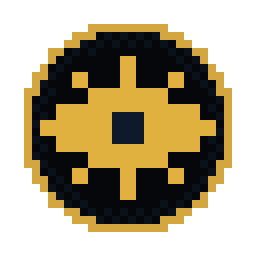

# Пиксельный задачник



Пиксельный таск-трекер, который живёт узкой полоской у правого края экрана на всю высоту (как Rusty's Retirement). Тёмная палитра, золотые рамки, CRT-фильтр, чиптюн-звуки и частицы при выполнении задач. Приложение на [Tauri](https://tauri.app): exe около 4,5 МБ, ~25 МБ памяти.

## Что умеет

- **Колонки по проектам** (Инбокс, Работа, Учёба, Дом, Хобби, Прочее), карточки перетаскиваются, двойной клик редактирует. «⌫ сделанные» убирает выполненное в архив.
- **Звук:** синтезируется на лету (Web Audio) в миноре. У каждой колонки своя тональность, комбо закрытых подряд задач идёт по аккордам i, VI, III, VII. С 3-й задачи вступает бас, с 5-й барабаны, с 7-й верхняя октава. Фанфара на закрытие колонки, тихий фоновый эмбиент, стерео/моно.
- **Уровни:** +1 опыт за задачу, 5 опыта = уровень. На уровнях 2–6 открываются новые скины.
- **Глаз-логотип** следит за курсором по всему экрану. Скины по клику, у секретных свои реакции на выполненную задачу. В выборе скинов и в настройках есть поле для секретного кода, а код «сброс» прячет все секреты.
- **Цели недели** (сворачиваются), **Дейлик** (раскрывающаяся табличка с заметками).
- **Источник задачи:** клик по бейджу открывает поповер со ссылкой на задачу (YouGile, Notion…).
- **Отчёт в буфер** в формате «Цели на неделю / Я за сегодня / Не сделано / План на завтра». Если локально запущена [Ollama](https://ollama.com) с моделью `qwen2.5:7b`, отчёт переписывается нейронкой живым языком, иначе копируется шаблон.
- **Экспорт в Obsidian** (markdown-чеклист), темы «луп» и «фиолет», CRT-фильтр.
- Всё хранится локально.

Синк с YouGile / Notion пока демо: кнопка «⟳ синк» добавляет примерные задачи.

## Скачать

**[Zadachnik.exe](https://github.com/eMRK-xd/pixel-zadachnik/releases/latest)** (Windows, ~4,5 МБ, без установки). Если SmartScreen предупредит: «Подробнее» → «Выполнить в любом случае».

## На телефон

Открой **[emrk-xd.github.io/pixel-zadachnik](https://emrk-xd.github.io/pixel-zadachnik/)** на телефоне и поставь как приложение: в Chrome на Android меню ⋮ → «Установить приложение», на iPhone в Safari «Поделиться» → «На экран „Домой“».

Чтобы задачи совпадали с компом, в настройках включи **⇅ синхронизацию** на обоих устройствах с одним и тем же токеном GitHub (Fine-grained token, доступ *Gists: read and write*). Задачи хранятся в твоём приватном гисте, токен остаётся только на устройстве.

## Запуск из исходников

Как страница: открой `web/index.html` в браузере.

Как приложение-полоска (Windows): нужны [Rust](https://rustup.rs) и Visual Studio Build Tools с компонентом C++.

```bash
npm install
npm run build
```

Готовый файл: `src-tauri/target/release/zadachnik.exe`.

- **Ctrl+Alt+T** показать/спрятать окно
- **⊤** поверх всех окон, **✕** спрятать в трей
- Значок-глаз в трее: показать, прижать к правому краю, выйти
- `zadachnik.exe --quit` аккуратно закрывает запущенную копию

## Сбор задач нейронкой (MCP)

В папке `mcp/` лежит MCP-сервер `zadachnik`. Подключаешь его к Claude (или любому клиенту с MCP), говоришь в чате, откуда собрать задачи, и они прилетают в Инбокс запущенного приложения с бейджем источника и ссылкой.

Инструменты:
- `list_tasks` — что уже есть на доске, цели недели и заметки дейлика (чтобы не дублировать);
- `add_tasks` — положить новые задачи в Инбокс (`text`, `source`: yougile / notion / daily / obsidian / claude, `url`, `column`). Дубли по тексту или ссылке отсеиваются.

```bash
cd mcp
npm install
claude mcp add --scope user zadachnik -- node "<путь к проекту>/mcp/server.js"
```

Пример запроса: «Собери мои задачи на сегодня: YouGile, последний дейлик и упоминания меня в Notion за неделю — и закинь в задачник». Нейронка ходит по источникам своими коннекторами (Notion, YouGile и т.д.) и вызывает `add_tasks`.

Как это устроено: приложение после каждого изменения пишет снимок в `%APPDATA%\com.pixel.zadachnik\tasks.json`, а сервер кладёт новые задачи в `inbox.json` рядом; приложение раз в ~2,5 секунды забирает их в Инбокс.

## Нейронка для отчёта (по желанию)

```bash
winget install Ollama.Ollama
ollama pull qwen2.5:7b
```

Модель работает полностью локально, задачи никуда не отправляются.

## Файлы

- `web/index.html` — всё приложение (разметка, стили, логика, звук, скины)
- `src-tauri/` — окно-полоска, трей, горячая клавиша, буфер, запросы к Ollama (Rust)
- `make-icon.js` — рисует пиксельную иконку `icon.ico` / `icon.png`
